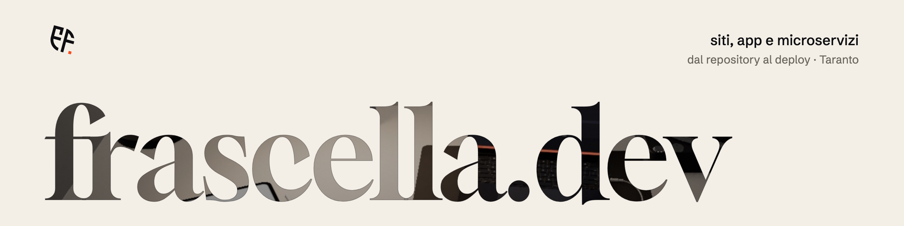
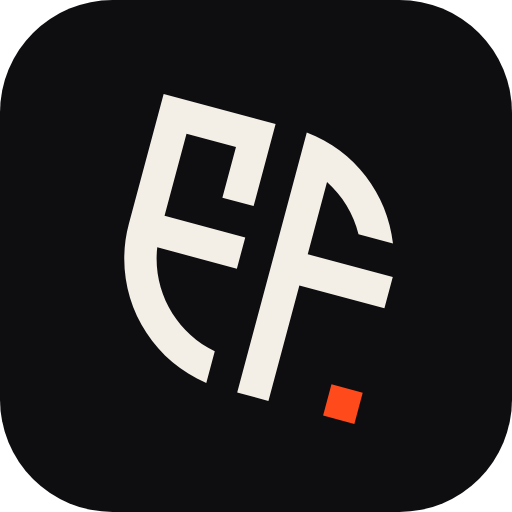

<picture>
  <source media="(prefers-color-scheme: dark)" srcset=".github/assets/banner-dark.png">
  
</picture>

<p align="center">
  <a href="https://github.com/frascella-dev/frascella.dev/releases"></a>
  
  
  
  
</p>

The website of **Emanuele Frascella**, freelance software engineer in Taranto:
[frascella.dev](https://www.frascella.dev).

A WordPress site laid out in **Elementor Pro**, in Italian and English with **Polylang**,
built from [Bottega](https://github.com/frascella-dev/bottega). This repository holds the
two pieces that are the site's own — the **frascella theme** (the look) and the
**frascella plugin** (the projects and the Elementor widgets) — next to two
general-purpose plugins that each live in their own repository.

## Features

- **The manifesto.** An Ink sheet with the big words cut out of it, and a 3D desk at night
  behind it (three.js), seen through the letters. Gloock and Schibsted Grotesk, served by
  the site. The words and the layout load first; the desk fades in when it is ready, and
  still pictures take its place where WebGL is missing.
- **A desk you can touch.** The lamp, the turntable, the mug, the tablet (you can draw on
  it), the phone and the plant answer a click, and the keyboard reaches them through
  switches that appear on Tab. The record plays a vinyl crackle, off with «audio off».
- **Built in the Elementor editor.** Words and pictures are Elementor's own widgets inside
  containers that carry the theme's classes. A frascella widget exists only where there
  is data or behaviour: the cut-out words, the desk, the works, the header and the footer.
- **Two languages.** Italian on `/`, English on `/en/`, written separately. Each Theme
  Builder document has a copy per language, and every widget's fields start from the
  page's language.
- **Portfolio in the admin.** The projects the home page shows, one tab per language,
  dragged into order, with drafts — built like the panels of the other plugins.
- **Search engines.** Titles, descriptions, canonical URLs, `hreflang`, Open Graph and a
  `Person` graph from the theme's `inc/content/who.php`; WordPress's own sitemap; the
  favicon, the Apple touch icon and a web app manifest.
- **Privacy that matches the code.** Visits are counted without cookies, and with two
  statistics cookies only after consent; the privacy notice reads from the live tracker
  whether the consent banner is published, and says exactly that.
- **No mail leaves a development machine.** Locally every email goes to Mailpit.

## The plugins it runs with

| Plugin | Version | What it does here |
|---|---|---|
| [Agenda](https://github.com/frascella-dev/agenda) | 1.2.0 | The contact form, drawn by the theme, and the inbox of requests |
| [Analytics Connector](https://github.com/frascella-dev/analytics) | 1.0.0 | Loads the visit statistics and the consent banner of [analytics.frascella.dev](https://analytics.frascella.dev) |

Also required: **Elementor**, **Elementor Pro** (installed with its licence, never
committed) and **Polylang**.

## Install

Download `frascella-theme-<version>.zip` and `frascella-plugin-<version>.zip` from the
[releases](https://github.com/frascella-dev/frascella.dev/releases). Then, on a WordPress
6.6+ site with PHP 8.2+:

1. Install and activate Elementor, Elementor Pro and Polylang (Italian first, then English).
2. Install Agenda and Analytics Connector from their releases.
3. Plugins → Add New → Upload: the frascella plugin, then Appearance → Themes → Upload: the
   frascella theme, and activate it.
4. Compose the site: `wp eval-file tools/setup-languages.php`, then
   `wp eval-file tools/site.php` (the projects, the home page, the privacy notice, the menus,
   the header and footer, the contact form). It is idempotent; `rebuild` writes it again.

More in [`docs/guidelines/10-release-and-deploy.md`](docs/guidelines/10-release-and-deploy.md).

## Documentation

| | |
|---|---|
| [01 · Principles](docs/guidelines/01-principles.md) | the rules everything else follows from |
| [02 · The plugin](docs/guidelines/02-plugin.md) | projects, migrations, the panel, WP-CLI |
| [03 · The theme](docs/guidelines/03-theme.md) | Vite, tokens, templates, motion, drawing another plugin |
| [04 · Elementor](docs/guidelines/04-elementor.md) | native or widget, the classes, widgets from a spec, the Kit |
| [05 · Words and languages](docs/guidelines/05-words-and-languages.md) | the content tree, Polylang, Theme Builder copies |
| [06 · SEO](docs/guidelines/06-seo.md) | head, robots, sitemap, structured data |
| [07 · Accessibility](docs/guidelines/07-accessibility.md) | the rules that caught real bugs, forms, motion |
| [08 · Privacy](docs/guidelines/08-privacy.md) | the notice says what the code does; analytics; handling data |
| [09 · Testing](docs/guidelines/09-testing.md) | the harness, driving Elementor's editor, email that never leaves |
| [10 · Release and deploy](docs/guidelines/10-release-and-deploy.md) | versions, zips, GitHub releases, the server, WP-CLI over SSH |
| [11 · Code style](docs/guidelines/11-code-style.md) | comments that say why, prefixes, CSS, TypeScript, commits |

## Develop

```sh
bin/setup                                         # → http://localhost:8110 (admin / admin) · Mailpit http://localhost:8135
bin/wp <command>                                  # WP-CLI
cd wp-content/themes/frascella && npm run build   # after CSS or TypeScript changes
cd wp-content/plugins/frascella && npm run build  # the Portfolio panel (wp-scripts)
```

`ELEMENTOR_PRO_ZIP=/path/to/elementor-pro.zip bin/setup` also installs Elementor Pro.
`docker compose down -v` forgets the database.

**Emails never leave.** Locally the mu-plugin (`wp-content/mu-plugins/local-mail.php`) sends
all mail to Mailpit, whatever the SMTP settings say. Tests use `@example.com` addresses only.

```sh
cd wp-content/plugins/frascella
npm test               # all of them
npm run test:widgets   # widget fields, on the page and in the editor, IT and EN
npm run test:editor    # every section in Elementor's preview
npm run test:languages # the Theme Builder documents, one per language
npm run test:contact   # the contact form, through Agenda, to Mailpit
npm run test:admin     # Portfolio: the projects, their order, capabilities
npm run test:a11y      # axe on every page, desktop and phone
```

With Claude Code, `.claude/` holds the skills and agents that follow the guidelines
(`release-deploy`, `verify`, `privacy-notice`, `site-words`…).

## Two rules

- **`/privacy` says what the code does.** When what the site collects changes, that page
  changes in the same release.
- **No invented facts about the business.** No reviews, numbers or claims nobody can back.

## Design

The icon and the banners come from the Sketch file `frascella.dev`: the EF monogram, and
the manifesto in miniature, with the desk seen through the letters. The sources are SVGs in
[`design/`](design/), exported with `node bin/export-assets.mjs` (the README's PNGs and the
site's icons); the notes are in [`docs/icon.md`](docs/icon.md).

<p align="center"></p>

## Layout

```
wp-content/
  themes/frascella/         the look
    inc/                    setup, assets (Vite manifest), head, schema, sitemap, the desk
    inc/content/            every word the theme says, per language; who.php, who the site belongs to
    template-parts/         the sections the widgets print
    agenda/                 Agenda's contact form, drawn by the theme
    assets/src/             CSS and TypeScript (the desk, three.js) → assets/dist (Vite)
    assets/icons/           favicon, touch icon, manifest
  plugins/frascella/        the projects and the widgets
    inc/                    projects, migrations, capabilities, Portfolio, REST, Polylang, media, CLI
    inc/elementor/          widgets from a spec, Theme Builder per language, camera stations, Kit
    src/                    the React panel → build/
    tests/e2e/              Playwright and axe
  mu-plugins/               local only: mail to Mailpit
tools/                      site.php and setup-languages.php: the site, composed; the form; the screenshots
bin/                        setup · wp · build-zips · export-assets.mjs
design/                     the SVG sources of the icon and the banners (.github/assets/)
docs/                       the guidelines
```
